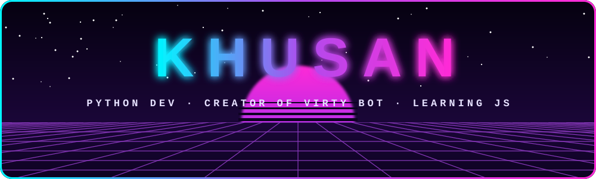
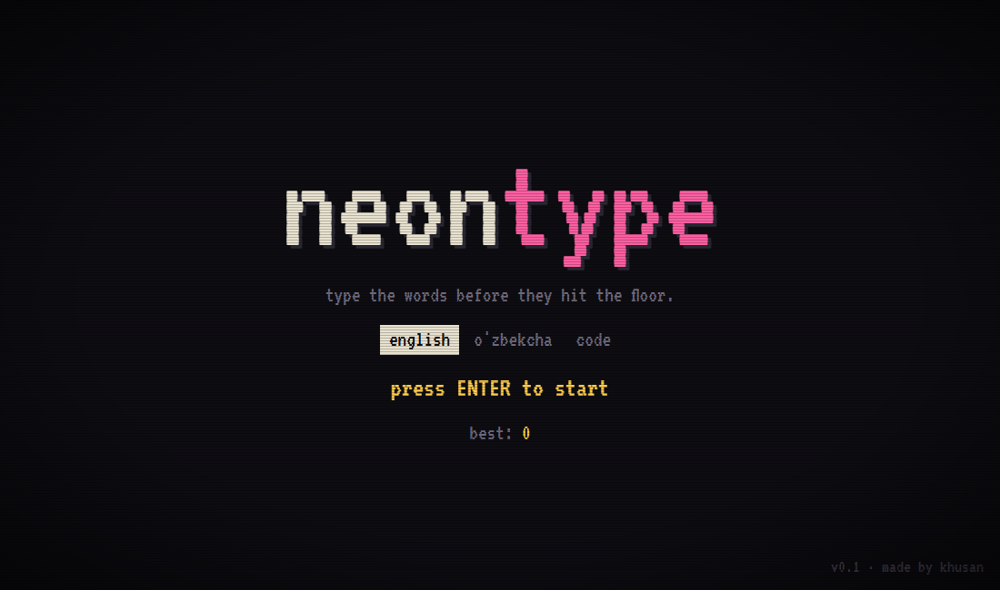

<!-- ===== HEADER ===== -->
<p align="center">
  <a href="https://github.com/husaniskandarov996-a11y"></a>
</p>

<!-- ===== TYPING TEXT ===== -->
<p align="center">
  <a href="https://github.com/husaniskandarov996-a11y">
    
  </a>
</p>

<!-- ===== BADGES ===== -->
<p align="center">
  <a href="https://t.me/virtyuz_bot"></a>
  <a href="https://github.com/husaniskandarov996-a11y?tab=followers"></a>
  <a href="https://github.com/husaniskandarov996-a11y"></a>
</p>

---

## 👋 Hey there! I'm Khusan

> **Python developer & Telegram bot builder.**
> *I love automation, clean dark-neon design, and turning ideas into tools that run by themselves.*

```python
class Khusan:
    role      = "Python Developer"
    building  = "VIRTY Bot ⭐"
    knows     = ["Python", "HTML", "CSS"]
    learning  = "JavaScript 🚀"
    loves     = ["Telegram bots", "Automation", "Dark neon UI 🌌"]
```

---

## 🛠️ Tech Stack

<p align="center">
  <a href="https://github.com/husaniskandarov996-a11y"></a>
</p>

---

<details>
<summary><h2>📂 My Projects <sub><sup>· click to open</sup></sub></h2></summary>

<br />

### 💎 VIRTY Bot

<p align="center">
  <a href="https://t.me/virtyuz_bot"></a>
</p>

<p align="center">
  <a href="https://t.me/virtyuz_bot">
    
  </a>
</p>

### 🎮 Neon Type

<p align="center">
  <a href="https://husaniskandarov996-a11y.github.io/neon-typing-game/"></a>
</p>

<p align="center">
  My first JavaScript game: type the falling words before they hit the floor.<br />
  <a href="https://husaniskandarov996-a11y.github.io/neon-typing-game/"><b>▶ play it</b></a> · <a href="https://github.com/husaniskandarov996-a11y/neon-typing-game">source code</a>
</p>

</details>

---

## 🚀 Space Battle

<p align="center">
  <a href="https://t.me/virtyuz_bot"></a>
</p>

<!-- ===== FOOTER ===== -->
<p align="center">
  <a href="https://github.com/husaniskandarov996-a11y"></a>
</p>
